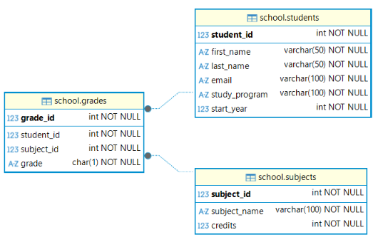

# Øvelse – Studentdatabase med SQL

I denne øvelsen skal vi lage en liten database for en skole. Databasen skal holde oversikt over **studenter, emner og karakterer**.

Vi har studenter fra tre ulike studier:

- Backend-programmering
- Frontend-utvikling
- Cybersikkerhet

Studentene kan ta flere emner, og hvert emne kan ha flere studenter. Når en student har fullført et emne, kan studenten få en karakter i emnet.

Databasen skal bestå av tre tabeller:

- `students`
- `subjects`
- `grades`

---

## Oppgave 1 – Opprett databasen og tabellene

Opprett en database med navnet:

```text
school
```



### Tabell: `students`

| Kolonne | Datatype | Regler |
|---|---|---|
| student_id | INT | PRIMARY KEY, AUTO_INCREMENT |
| first_name | VARCHAR(50) | NOT NULL |
| last_name | VARCHAR(50) | NOT NULL |
| email | VARCHAR(100) | NOT NULL, UNIQUE |
| study_program | VARCHAR(100) | NOT NULL |
| start_year | INT | NOT NULL |

### Tabell: `subjects`

| Kolonne | Datatype | Regler |
|---|---|---|
| subject_id | INT | PRIMARY KEY, AUTO_INCREMENT |
| subject_name | VARCHAR(100) | NOT NULL, UNIQUE |
| credits | INT | NOT NULL |

### Tabell: `grades`

| Kolonne | Datatype | Regler |
|---|---|---|
| grade_id | INT | PRIMARY KEY, AUTO_INCREMENT |
| student_id | INT | NOT NULL, FOREIGN KEY |
| subject_id | INT | NOT NULL, FOREIGN KEY |
| grade | CHAR(1) | NOT NULL |

`student_id` skal referere til en student i `students`.

`subject_id` skal referere til et emne i `subjects`.

En student skal bare kunne ha **én registrert karakter per emne**.

### Krav

SQL-scriptet skal:

1. Slette databasen dersom den allerede finnes.
2. Opprette databasen `school`.
3. Velge databasen.
4. Opprette de tre tabellene.
5. Opprette nødvendige primærnøkler og fremmednøkler.
6. Sørge for at e-postadressen til en student er unik.
7. Sørge for at samme student ikke kan få registrert to karakterer i samme emne.

Tenk over:

- Hvilke tabeller må opprettes før `grades`?
- Hvorfor kan ikke `grades` opprettes først?
- Hva er primærnøkkelen i hver tabell?
- Hvilke kolonner er fremmednøkler?
- Hvorfor trenger vi en egen `grades`-tabell?
- Hvorfor ligger ikke `grade` direkte i `students`?

---
